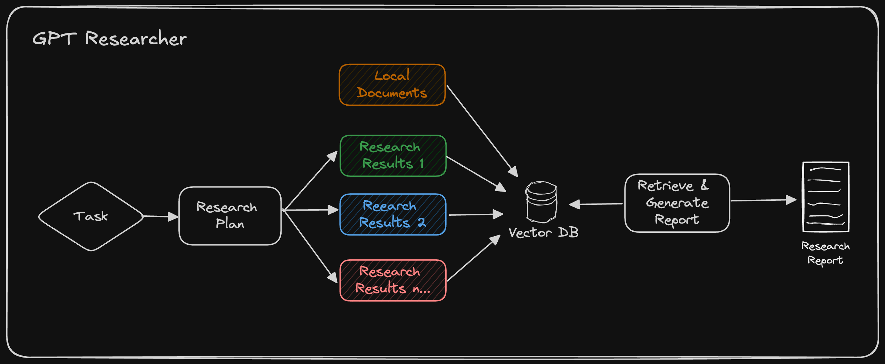

# Local Documents

## Just Local Docs

You can instruct the GPT Researcher to run research tasks based on your local documents. Currently supported file formats are: PDF, plain text, CSV, Excel, Markdown, PowerPoint, and Word documents.

Step 1: Add the env variable `DOC_PATH` pointing to the folder where your documents are located.

```bash
export DOC_PATH="./my-docs"
```

Step 2: 
 - If you're running the frontend app on localhost:8000, simply select "My Documents" from the "Report Source" Dropdown Options.
 - If you're running GPT Researcher with the [PIP package](https://docs.tavily.com/docs/gpt-researcher/gptr/pip-package), pass the `report_source` argument as "local" when you instantiate the `GPTResearcher` class [code sample here](https://docs.gptr.dev/docs/gpt-researcher/context/tailored-research).

## PDF Text Extraction

Local PDFs and downloaded online documents use LangChain's `PyPDFLoader`,
backed by [pypdf](https://pypdf.readthedocs.io/) (BSD-3-Clause). The default
installation no longer requires PyMuPDF. The web PDF scraper and browser PDF
helpers use the same parser, including the browser's arXiv full-text path.

The parser reads each page's existing text layer. It does not perform OCR:
image-only scans need OCR preprocessing, and password-protected documents need
to be decrypted before use. The web scraper logs a warning when it cannot
extract text. Layout, whitespace and reading order can differ from earlier
PyMuPDF-based releases, particularly for complex multi-column documents.

For custom integrations, use `PyPDFScraper` from `gpt_researcher.scraper`.
The previous `PyMuPDFScraper` import remains available as an alias to the new
implementation; it no longer selects the PyMuPDF library. Existing HTTP session
headers, download timeouts, all-page extraction and the `(text, images, title)`
return shape are retained.

## Local Docs + Web (Hybrid)



Check out the blog post on [Hybrid Research](https://docs.gptr.dev/blog/gptr-hybrid) to learn more about how to combine local documents with web research.
```
